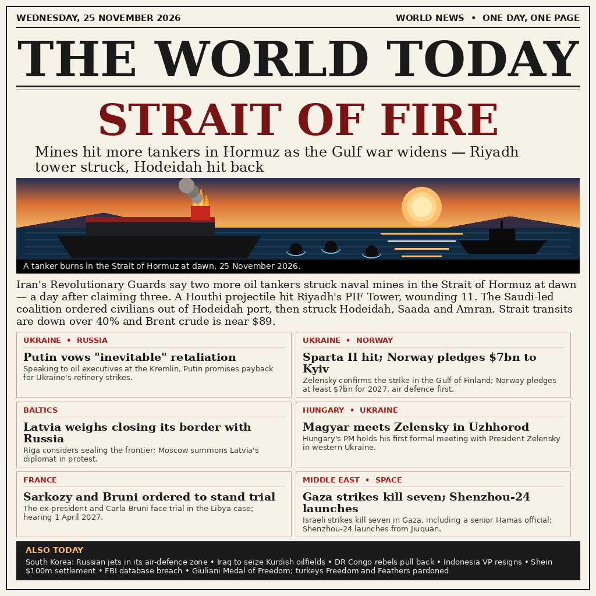

# Strait of Fire — The World Today, Wednesday 25 November 2026

Play make.fun bounties with me: https://make.fun/r/v4m1pbv2

A newspaper front page summing up Wednesday 25 November 2026's world news
in one image: the Gulf escalation leads, with the day's other big stories
from Ukraine, Europe, the Middle East and space.

## The day's news

- **Lead — Strait of Fire.** Iran's Revolutionary Guards say two more oil
  tankers struck naval mines in the Strait of Hormuz at dawn, a day after
  claiming three. A Houthi projectile hit Riyadh's PIF Tower, wounding 11.
  The Saudi-led coalition ordered civilians out of Hodeidah port, then
  struck Hodeidah, Saada and Amran. Strait transits are down over 40% and
  Brent crude is near $89.
- **Putin vows "inevitable" retaliation** for Ukraine's strikes on Russian
  refineries, speaking to oil executives at the Kremlin.
- **Ukraine hits the cargo ship Sparta II** in the Gulf of Finland, Zelensky
  confirms; Norway pledges at least $7bn to Ukraine in 2027, air defence first.
- **Latvia weighs closing its border with Russia;** Moscow summons Latvia's
  diplomat.
- **Hungary's PM Péter Magyar meets Zelensky** in Uzhhorod — their first
  formal meeting.
- **Sarkozy and Carla Bruni ordered to stand trial** in the Libya corruption
  case; pre-trial hearing 1 April 2027.
- **Israeli strikes in Gaza kill seven,** including a senior Hamas security
  official.
- **China's Shenzhou-24 crewed mission** launches successfully from Jiuquan.
- Also today: Russian jets entered South Korea's air-defence zone; Iraq
  orders federal forces to seize Kurdish oilfields; DR Congo rebels pull
  back after heavy clashes; Indonesia's vice-president resigns; Shein agrees
  a $100m US settlement; the FBI crime database is hit by a suspected breach;
  Trump awards Rudy Giuliani the Medal of Freedom and pardons Thanksgiving
  turkeys Freedom and Feathers.

## How it works

`gen_image.py` draws the front page (1024×1024 PNG) with Pillow at build
time — masthead, headline, a hand-drawn dawn scene over the Strait of
Hormuz, six story cards and a footer ticker of briefs. Re-running
`gen_image.py` reproduces the identical PNG. `main.py` (Python
3.13, standard library only, no network) validates the PNG — signature,
1024×1024 header, every chunk CRC, complete IEND, at most 1 MiB — then
copies `entry.png` to `$MAKEFUN_OUTPUT_DIR/entry.png` (default `/output`)
and verifies the copy hashes exactly like the source. Running it twice
produces byte-identical output.
